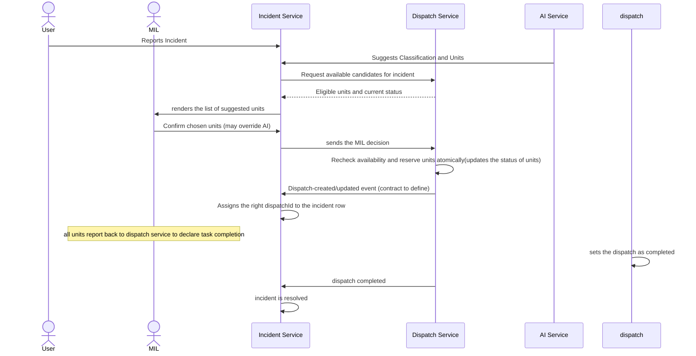

# 🚨 CodeRed Dispatch Service — Design & Delivery Plan

> **Status:** Working design draft  
> **Scope:** Dispatch Service domain, workflow, API, persistence, and integrations  
> **Implementation rule:** Resolve the open decisions in this document before locking the first API or database migration.

---

## 🧭 1. Purpose and boundaries

Dispatch Service coordinates the response to an approved incident. A dispatch belongs to one incident and may contain **multiple units**, including units of the same or different types.

| Concern | Owner |
|---|---|
| Incident details, classification, approval, and resolution | Incident Service / authorized human operator |
| Unit and station records, unit availability, dispatch records, assignments, and dispatch history | Dispatch Service |
| Unit recommendations | AI Service, as decision support only |
| Notifications | Notification Service |

The MIL (Man in the Loop) always makes the operational decision. AI can recommend units and quantities, but it cannot assign, reassign, cancel, or complete a dispatch.

The incident may store a `dispatchId` UUID as a reference. It is an identifier only: Dispatch Service remains the source of truth for the dispatch and its unit assignments. Do not use a cross-database entity relationship.

---

## 🟢 2. Agreed domain rules

### Dispatch

- A dispatch is the coordinated response to one incident.
- A dispatch contains one or more unit assignments.
- The MIL creates/confirms the dispatch and controls assignment changes and cancellation. These actions must be authorized and audited.
- A dispatch starts as `IN_PROGRESS` after at least one eligible unit has been assigned successfully.
- `COMPLETED` means the incident is resolved and all dispatched units have reported that their work is done. Units may still be returning to their stations.
- `CANCELLED` and `COMPLETED` are terminal dispatch states.

### Unit

Current unit statuses:

| Status | Meaning |
|---|---|
| `READY` | Available at its station for assignment |
| `ASSIGNED` | Assigned to an active dispatch; remains so while deployed and returning |
| `OUT_OF_SERVICE` | Unavailable because of repair, malfunction, or another operational reason |

A unit becomes `ASSIGNED` when Dispatch Service confirms its assignment. It returns to `READY` only after it has returned to its station and is fit for service. If it returns with a fault, it becomes `OUT_OF_SERVICE` instead. A unit must not be offered as available while `ASSIGNED` or `OUT_OF_SERVICE`.

### Assignment history

Record who performed each change and when. At minimum, history should capture assignment, removal/reassignment, unit work completion, return to station, cancellation, and dispatch completion. Keep history append-only; changing the current assignment must not erase prior actions.

---

## 🟡 3. Proposed end-to-end workflow

**Key boundary:** AI output is a proposal. The MIL's explicit confirmation is the command that changes operational state. Dispatch Service revalidates unit availability at confirmation time because a candidate list can become stale.

### Recommendation data flow

Dispatch Service owns the authoritative unit inventory and availability. A recommendation should be based on a current candidate snapshot supplied by Dispatch Service, rather than giving the AI Service direct ownership of or unrestricted access to unit state. The AI request should use already-known incident classification/context where possible; avoid resending the full incident description unless the recommendation genuinely needs it.

For the first implementation, use a transparent deterministic candidate ordering/filter. Proximity ranking and AI-driven quantity suggestions can be added after the core assignment workflow is reliable and the request/response contract is agreed.

---

## 🔵 4. Proposed data model

These are logical entities; names and field types can be finalized during the schema review.

### `Dispatch`

- `id` (UUID)
- `incidentId` (UUID, unique )
- `status` (`IN_PROGRESS`, `COMPLETED`, `CANCELLED`)
- `createdAt`, `updatedAt`
- `createdBy` (authenticated MIL Id)
- Optional terminal metadata: `completedAt` / `completedBy`, `cancelledAt` / `cancelledBy` / `cancellationReason`

### `Unit`

- `id` (UUID)
- `unitCode` (string)
- `ServiceType` (Enum)
- `stationId` (UUID)
- `status` (string)
- `operationalMetadata` (JSONB) (to be discussed)

#### `Station`

- `id` (UUID)
- `name` (string)
- `location` (JSONB)
- `serviceType` (Enum)
- `operationalMetadata` (JSONB) (to be discussed)

### `ServiceType`
- `PARAMEDIC`
- `FIREFIGHTER`
- `POLICE`
- `UnitType`: define the allowed values (for example police, paramedic, firefighter) and whether the type represents a service category or a specific capability.

Prefer an internal responder/user identifier over a national ID such as `CIN` unless there is a documented requirement to store that sensitive identifier.

---

## 🟣 5. API proposal

Routes below are proposals, not frozen contracts. Authentication is carried in the `Authorization` header, never as a JSON field. Use DTOs rather than exposing persistence entities.

| Operation | Proposed endpoint | Purpose |
|---|---|---|
| Find candidates | `POST /api/dispatches/candidates` | Query available units using incident location, required types, and severity/context. A body is useful for structured query input. |
| Confirm dispatch | `POST /api/dispatches` | Create a dispatch for an incident with the MIL-selected unit IDs. Support an idempotency key. |
| Read dispatch | `GET /api/dispatches/{dispatchId}` | Return dispatch state, active assignments, and relevant history. |
| Add units | `POST /api/dispatches/{dispatchId}/assignments` | Add one or more eligible units after revalidating availability. |
| Remove/reassign units | `DELETE /api/dispatches/{dispatchId}/assignments/{assignmentId}` or explicit reassignment command | Record the MIL action and release/reserve units according to policy. |
| Record work completion | `POST /api/dispatches/{dispatchId}/assignments/{assignmentId}/work-completion` | Record the unit chief's report, with the required MIL confirmation policy to be decided. |
| Record return | `POST /api/dispatches/{dispatchId}/assignments/{assignmentId}/return` | Mark the unit back at its station and set it to `READY` or `OUT_OF_SERVICE`. |
| Cancel dispatch | `POST /api/dispatches/{dispatchId}/cancellation` | Cancel with actor, timestamp, and reason; apply unit release rules. |
| Complete dispatch | `POST /api/dispatches/{dispatchId}/completion` | Complete only when the incident is resolved and all assigned units have completed their work. |

Use `409 Conflict` when a selected unit is no longer available or a state transition is invalid; `400` for malformed input; `403` for an authenticated user without the required authority; and `404` when the dispatch/assignment does not exist. Define a consistent error response before implementation.

---

## 🟠 6. Events and service integration

Define versioned event schemas before connecting the services. Candidate events include:

- Incident Service → Dispatch Service: approved incident context, if dispatch creation is event-triggered in the final design.
- Dispatch Service → Incident Service: dispatch created/changed/completed/cancelled, including `eventId`, `occurredAt`, `schemaVersion`, `incidentId`, and `dispatchId`.
- Dispatch Service → Notification Service: operational changes that users need to be notified about.

Choose one clear initiation model: either the MIL calls Dispatch Service to request/confirm a dispatch, or Incident Service emits an approval event that creates a pending workflow. Do not let both paths create dispatches without idempotency and a defined source of authority.

For RabbitMQ delivery, design for duplicate delivery and retries. If the database update and event publication must be reliable as one business operation, evaluate a transactional outbox. Consumers should be idempotent using the event ID or another stable key. AI recommendations should not be treated as domain events that directly mutate dispatch state.

---

## 🔴 7. Decisions to resolve before coding

1. Is there exactly one dispatch per incident, or may an incident have multiple dispatch records over time (for example after cancellation/reopening)?
2. Can an assignment be removed while its unit is deployed? If so, what unit status follows, and who confirms the unit is physically available again?
3. Does the unit chief report completion directly, or does the MIL record/confirm that report? Which identity and authorization represent the unit chief?
4. Is `COMPLETED` allowed while units are still returning? Current definition says yes when work is done; confirm that return is tracked separately from dispatch completion.
5. How does Incident Service communicate that an incident is resolved, and which system is authoritative for that fact?
6. What exactly makes a unit eligible: type, station, status, crew count, capability, or other constraints?
7. Does a station support several unit types? Should a unit have one primary type or multiple capabilities?
8. Which operations are restricted to the MIL, and how are roles/permissions represented in the current Keycloak setup?
9. Should the AI Service receive incident description directly, or can it use classification/context already produced by the classification workflow?

Record the answers in the contract and schema before creating migrations. The first implementation should not silently decide these policies.

---

## 🧱 8. Delivery epics and task order

### Epic 1 — Domain and contract baseline

- Resolve the open decisions above.
- Write the dispatch state and unit status transition tables.
- Agree API DTOs and versioned event schemas with Incident and Notification services.
- Define authorization, idempotency, and audit requirements.

**Exit criteria:** reviewed design; no unresolved decision that changes the first migration or confirmation flow.

### Epic 2 — Dispatch persistence and core vertical slice

- Add migrations for dispatch, assignments, unit, station, and audit/history as scoped.
- Implement candidate listing from Dispatch Service's own unit inventory.
- Implement MIL confirmation for one incident and one or more selected units.
- Recheck/reserve units atomically and persist dispatch plus assignments.
- Expose an authorized dispatch read endpoint.

**Exit criteria:** a confirmed dispatch can be created, queried, and cannot reserve an unavailable/already-assigned unit.

### Epic 3 — Assignment and dispatch lifecycle

- Add/remove/reassign units under the agreed policy.
- Record unit work completion and return-to-station separately.
- Implement cancellation and completion transition guards.
- Preserve a full actor-attributed history.

**Exit criteria:** allowed transitions succeed, invalid transitions fail without corrupting unit availability or history.

### Epic 4 — Cross-service events and recommendation integration

- Publish/consume the approved contracts with versioning and idempotency.
- Add retry and dead-letter behavior appropriate to each consumer.
- Connect AI recommendations as advisory output; require MIL confirmation for every assignment.
- Use an outbox if required by the chosen consistency guarantee.

**Exit criteria:** duplicate or delayed messages do not create duplicate dispatches or assignments; AI output alone never changes operational state.

### Epic 5 — Operational readiness

- Add structured logs with correlation/trace identifiers and no unnecessary sensitive incident data.
- Provide health/readiness behavior and service-level metrics.
- Document local setup, configuration, and common failure handling.
- Verify through the gateway and real Docker dependencies.

**Exit criteria:** the end-to-end flow and key dependency failures are observable and diagnosable.

### Later platform epics

1. CI/CD and reproducible container delivery.
2. Shared observability: dashboards, traces, alerts, and log aggregation.
3. Kubernetes deployment, configuration/secrets, probes, resource limits, ingress, and rollback.
4. Recovery, backup, load, and operational failure exercises.

Build the service workflow and its operational signals before encoding it into Kubernetes deployment patterns.

---

## ✅ 9. First vertical slice acceptance checklist

- [ ] MIL submits an approved `incidentId` and one or more unit IDs.
- [ ] The service validates the request and confirms the incident/approval context using the agreed contract.
- [ ] Every selected unit is still `READY` at confirmation time.
- [ ] Dispatch and assignments persist in one database transaction.
- [ ] Each assigned unit becomes `ASSIGNED` exactly once; concurrent duplicate assignment is rejected.
- [ ] Repeating the same command with the same idempotency key does not create a second dispatch.
- [ ] The response returns the dispatch ID, status, and assigned unit summaries.
- [ ] The incident can store the returned dispatch UUID without a cross-database relationship.
- [ ] Actor, timestamp, and action are recorded for audit.
- [ ] Authorized users can read the dispatch; unauthorized users cannot.

> 📝 **Scope note:** Proximity ranking, AI quantity recommendations, automatic dispatch, and Kubernetes are intentionally later increments. The first slice proves safe human-confirmed assignment and correct ownership.